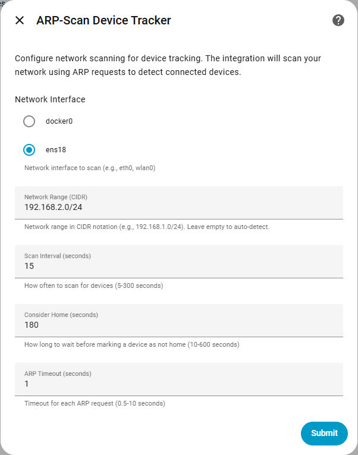
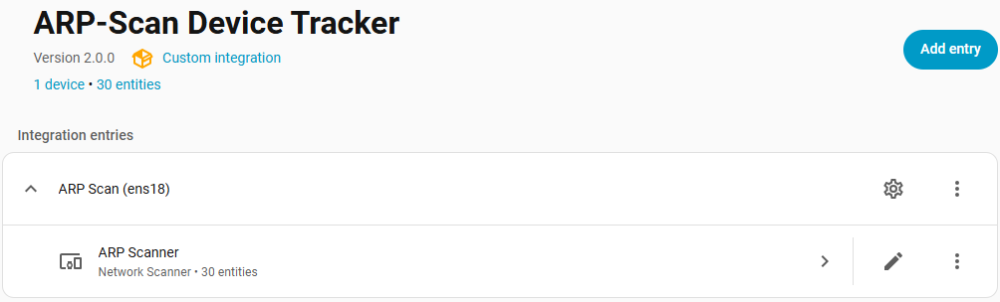
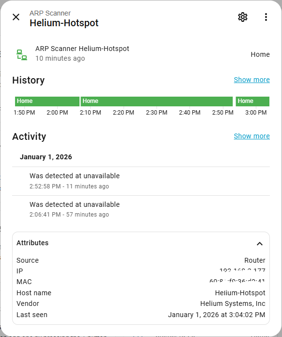
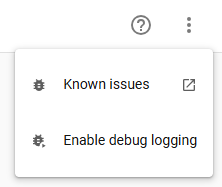

[![GitHub Release][releases-shield]][releases]
[![GitHub Activity][commits-shield]][commits]
[![License][license-shield]](LICENSE)
![Project Maintenance][maintenance-shield]

[](https://www.paypal.me/cyberjunkynl/)
[](https://github.com/sponsors/cyberjunky)

# ARP-Scan Device Tracker Integration

A Home Assistant custom integration that tracks devices on your network using ARP (Address Resolution Protocol) scanning. Which works very fast and is very accurate. This integration uses a pure Python implementation - no external `arp-scan` command required!

## Supported Features

- **Pure Python**: No external dependencies like `arp-scan` command needed
- **GUI Configuration**: Easy setup through Home Assistant's UI (no YAML required)
- **Auto-detection**: Automatically detects network interface and range
- **Vendor Lookup**: Identifies device manufacturers via OUI database
- **Include/Exclude Lists**: Filter devices by IP address
- **Sleeping Phones**: Known devices that miss a scan are woken up and probed directly, so phones in Wi-Fi power save don't flap between home and away
- **Diagnostics**: Download the latest scan result from the integration page

## Device Tracker

The integration creates a device tracker for each device found on your network, with a status `home`/`not_home`. Devices are checked every 15 seconds: the known devices get an ARP request addressed to them directly, and every 5 minutes the whole network is swept with broadcast ARP to find new devices. A known device that disappears triggers an early sweep (at most once a minute), in case it moved to a new IP address. This keeps broadcast traffic low, which Wi-Fi networks and ESP32-based devices handle poorly.

If a scan fails (for example a missing permission or an interface that went down), the trackers become `unavailable` until scanning works again, instead of reporting everyone as away.

## Entity Attributes

Each tracked device exposes these attributes:

| Attribute | Description |
|-----------|-------------|
| `mac` | MAC address of the device |
| `ip` | Current IP address |
| `vendor` | Device manufacturer (from OUI database) |
| `last_seen` | Timestamp of last detection |

## Screenshots

   

## Installation

Requires Home Assistant 2026.3.0 or newer.

### HACS (Recommended)

[](https://my.home-assistant.io/redirect/hacs_repository/?owner=cyberjunky&repository=home-assistant-arpscan_tracker&category=integration)

Alternatively:

1. Ensure [HACS](https://hacs.xyz) is installed
2. Search for "ARPScan" in HACS
3. Click **Download**
4. Restart Home Assistant
5. Add via Settings → Devices & Services
6. Search for "ARP-Scan" and follow the setup wizard

### Manual Installation

1. Copy the `custom_components/arpscan_tracker` folder to your `<config>/custom_components/` directory
2. Restart Home Assistant
3. Add via Settings → Devices & Services

## Configuration

### GUI Setup

1. Go to **Settings → Devices & Services**
2. Click **+ Add Integration**
3. Search for "ARPScan"
4. Select your network interface (auto-detected)
5. Optionally adjust the network range, or enter specific hosts to probe
6. Click Submit

The other options are available afterwards under **Configure**. To change the interface or network later, use **Reconfigure** from the integration's menu.

### Configuration Options

| Option | Default | Description |
|--------|---------|-------------|
| **Network Interface** | Auto-detect | Network interface to scan (e.g., `eth0`, `wlan0`) |
| **Network Range** | Auto-detect | Network in CIDR notation (e.g., `192.168.1.0/24`), at most 1024 addresses (a `/22`) unless specific hosts are probed |
| **Consider Home** | 180 seconds | Time before marking device as not_home (10-1800) |
| **Resolve Hostnames** | Enabled | Look up device hostnames via reverse DNS |
| **Enable Found Devices** | Enabled | Enable newly found device tracker entities by default |
| **Track New Devices** | Enabled | Automatically create entities for newly discovered devices |
| **Specific Hosts** | Empty | Probe only these IPs (for ZeroTier/VPN networks) |
| **Include IPs** | Empty | Only track these IP addresses (comma-separated) |
| **Exclude IPs** | Empty | Skip tracking these IP addresses (comma-separated) |

### Device Name Resolution

When **Resolve Hostnames** is enabled, the integration performs reverse DNS lookups to find device hostnames:

- If a hostname is found (e.g., `skull-nuc`), it becomes the device's name
- If no hostname is found, the MAC address (without colons) is used
- Hostnames are cached for an hour, so a slow DNS server doesn't slow down the scans

This is useful for identifying devices by their configured network names rather than just IP addresses.

### Options Flow

After initial setup, you can modify settings via:
1. Go to **Settings → Devices & Services**
2. Find the ARP-Scan integration
3. Click **Configure**

> [!NOTE]
> Every device tracker gets a device, identified by its MAC address. If another integration (like your router) already knows that MAC, Home Assistant links the tracker to that device.
> Devices you no longer need can be deleted from the device page.
> When **Enable Found Devices** is off, new device trackers are added but disabled by default—enable them in the Home Assistant UI.
> When **Track New Devices** is off, only previously known devices are tracked—new discoveries are ignored.

## Removing the Integration

1. Go to **Settings → Devices & Services → ARP-Scan**
2. Open the menu (⋮) of the entry and select **Delete**
3. If you installed via HACS, remove the repository in HACS as well and restart Home Assistant

Deleting the entry removes all its device trackers and their devices. Automations using them need to be updated.

## YAML Configuration

Configuration via `configuration.yaml` was removed in version 2.2.0. If you still have a `device_tracker` entry with `platform: arpscan_tracker`, remove it and add the integration via the UI.

## Permissions

This integration uses raw sockets to send ARP packets. Depending on your installation type:

| Installation | Status |
|--------------|--------|
| **Home Assistant OS** | ✅ Works out of the box |
| **Supervised** | ✅ Works out of the box |
| **Container** | ⚠️ Requires `--cap-add=NET_RAW` |
| **Core** | ⚠️ Requires `CAP_NET_RAW` capability |

### Docker Example

```bash
docker run -d --name homeassistant \
  --cap-add=NET_RAW \
  --network=host \
  -v /path/to/config:/config \
  homeassistant/home-assistant:latest
```

## Troubleshooting

### Common Issues

**No devices found**

1. Verify the correct network interface is selected
2. Check that the network range is correct
3. Ensure Home Assistant has network permissions (see Permissions section)
4. Check logs for permission errors

**Permission denied errors**

If you see "Permission denied for ARP scan" in the logs:
- **Docker**: Add `--cap-add=NET_RAW` to your container
- **Core**: Run with `sudo` or add `CAP_NET_RAW` capability

**Phones flapping between home and away**

Phones in Wi-Fi power save (notably Samsung/Android and iPhones) ignore broadcast ARP requests while asleep. Once a phone has been seen, every scan that misses it sends it a wake-up packet and an ARP request addressed to the phone itself, which it answers far more reliably. A phone that ignores all traffic in deep sleep can still drop out; raise **Consider Home** for those. Phones that use a new random Wi-Fi MAC address on every connection show up as a new device each time; use a fixed (per-network) private address instead.

**Devices are unavailable**

The last scan failed. The error is in the Home Assistant log, and in the diagnostics download on the integration page.

**ZeroTier / VPN networks not detecting devices**

ZeroTier and similar VPN solutions intercept ARP broadcasts, so the normal network scan won't find devices. Use the **Specific Hosts** option to probe individual IPs:

1. Go to **Settings → Devices & Services → ARP-Scan → Configure**
2. In **Specific Hosts (IPs)**, enter the IP addresses you want to track: `192.168.0.20, 192.168.4.20`
3. Click Submit

The scanner will send individual ARP requests directly to those IPs instead of broadcasting to the subnet.

> [!NOTE]
> **Specific Hosts** vs **Include IPs**: 
> - **Specific Hosts** changes *how* the scanner works (probes only listed IPs)
> - **Include IPs** is a *filter* on the results (still scans everything, but only tracks listed IPs)

### Enable Debug Logging

Enable debug logging in `configuration.yaml`:

```yaml
logger:
  default: info
  logs:
    custom_components.arpscan_tracker: debug
```

Alternatively, enable debug logging via the UI in **Settings** → **Devices & Services** → **ARP-Scan** → **Enable debug logging**:



Then perform any steps to reproduce the issue and disable debug logging again. It will download the relevant log file automatically.

## Automation Examples

### Notify When Device Leaves Network

Send a notification when a device has been away for 1 hour:

```yaml
alias: "Device Left Network"
triggers:
  - trigger: state
    entity_id:
      - device_tracker.arpscan_tracker_1c697a658c2  # Replace with your device
    from: home
    to: not_home
    for:
      hours: 0
      minutes: 10
      seconds: 0
conditions: []
actions:
  - action: notify.mobile_app_phone
    data:
      message: "Device {{ trigger.to_state.name }} has left the network"
mode: single
```

### Notify When Device Comes Online

```yaml
alias: "Device Connected"
triggers:
  - trigger: state
    entity_id:
      - device_tracker.arpscan_tracker_1c697a658c2
    from: not_home
    to: home
conditions: []
actions:
  - action: notify.mobile_app_phone
    data:
      message: "{{ trigger.to_state.name }} is back online!"
mode: single
```

### Template Sensor: Convert to Online/Offline

Create a binary sensor that shows `on`/`off` instead of `home`/`not_home`:

```yaml
# configuration.yaml
template:
  - binary_sensor:
      - name: "Server Online"
        unique_id: server_online_status
        device_class: connectivity
        state: "{{ is_state('device_tracker.arpscan_tracker_1c697a658c2', 'home') }}"
        attributes:
          ip: "{{ state_attr('device_tracker.arpscan_tracker_1c697a658c2', 'ip') }}"
          mac: "{{ state_attr('device_tracker.arpscan_tracker_1c697a658c2', 'mac') }}"
          last_seen: "{{ state_attr('device_tracker.arpscan_tracker_1c697a658c2', 'last_seen') }}"
```

This creates a `binary_sensor.server_online` entity with:
- State: `on` (Connected) / `off` (Disconnected)
- Device class `connectivity` for proper UI icons

### Turn Off Lights When Everyone Leaves

```yaml
alias: "Everyone Left - Lights Off"
triggers:
  - trigger: state
    entity_id:
      - device_tracker.arpscan_tracker_phone1
      - device_tracker.arpscan_tracker_phone2
    to: not_home
    for:
      minutes: 10
conditions:
  - condition: state
    entity_id: device_tracker.arpscan_tracker_phone1
    state: not_home
  - condition: state
    entity_id: device_tracker.arpscan_tracker_phone2
    state: not_home
actions:
  - action: light.turn_off
    target:
      entity_id: light.living_room
mode: single
```


## Development

Requires Python 3.14 (same as Home Assistant 2026.3 and newer).

Quick-start (from project root):

```bash
python3 -m venv .venv
source .venv/bin/activate
python -m pip install --upgrade pip
pip install -r requirements_lint.txt
./scripts/lint    # runs pre-commit + vulture
# or: ruff check .
# to auto-fix: ruff check . --fix
```

## 💖 Support This Project

If you find this library useful for your projects, please consider supporting its continued development and maintenance:

### 🌟 Ways to Support

- **⭐ Star this repository** - Help others discover the project
- **💰 Financial Support** - Contribute to development and hosting costs
- **🐛 Report Issues** - Help improve stability and compatibility
- **📖 Spread the Word** - Share with other developers

### 💳 Financial Support Options

[](https://www.paypal.me/cyberjunkynl/)
[](https://github.com/sponsors/cyberjunky)

**Why Support?**

- Keeps the project actively maintained
- Enables faster bug fixes and new features
- Supports infrastructure costs (testing, AI, CI/CD)
- Shows appreciation for hundreds of hours of development

Every contribution, no matter the size, makes a difference and is greatly appreciated! 🙏

## Community

Questions, ideas or just want to chat? Join The Junkyard on Discord:

<a href="https://discord.gg/hUBQxRhJCU">
  
</a>

## License

This project is licensed under the MIT License - see the [LICENSE](LICENSE) file for details.

---

[releases-shield]: https://img.shields.io/github/release/cyberjunky/home-assistant-arpscan_tracker.svg?style=for-the-badge
[releases]: https://github.com/cyberjunky/home-assistant-arpscan_tracker/releases
[commits-shield]: https://img.shields.io/github/commit-activity/y/cyberjunky/home-assistant-arpscan_tracker.svg?style=for-the-badge
[commits]: https://github.com/cyberjunky/home-assistant-arpscan_tracker/commits/main
[license-shield]: https://img.shields.io/github/license/cyberjunky/home-assistant-arpscan_tracker.svg?style=for-the-badge
[maintenance-shield]: https://img.shields.io/badge/maintainer-cyberjunky-blue.svg?style=for-the-badge
